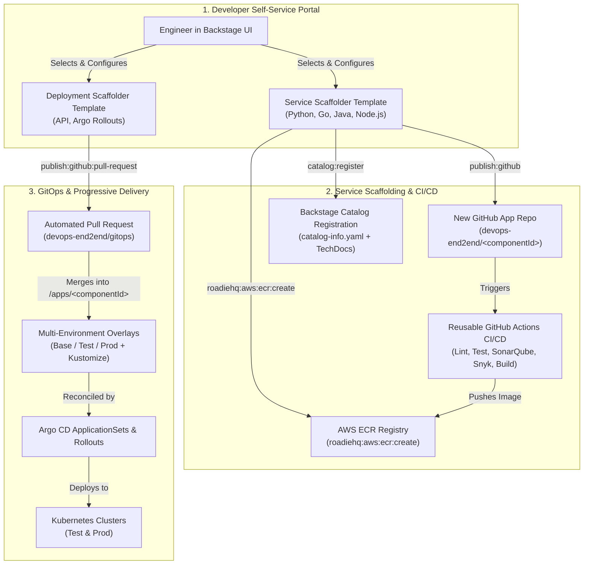

# Backstage Golden Path Scaffolding Templates

[](https://backstage.io/)
[](https://kubernetes.io/)
[](https://argoproj.github.io/cd/)
[](https://argoproj.github.io/rollouts/)
[](https://kustomize.io/)
[](https://github.com/features/actions)

A production-grade collection of **Spotify Backstage Software Scaffolder Templates** implementing enterprise **"Golden Paths"** for modern engineering organizations. 

This repository provides software and platform engineers with a fully automated, self-service developer portal experience:
- **Instant Service Scaffolding:** Spin up standardized, production-ready microservices across multiple languages (Python FastAPI, Go, Java Spring Boot, Node.js Express, and React/Vite).
- **Automated Infrastructure & Cloud Provisioning:** Provisions AWS ECR container repositories and sets up multi-arch container build pipelines via GitHub Actions.
- **GitOps-Native Kubernetes Deployment:** Generates multi-environment Kustomize manifests (Base, Test, Prod), Gateway API routes, Prometheus metrics/alerts, and Argo CD ApplicationSets. Automatically submits Pull Requests to the organization's central GitOps repository.

---

## Architecture & End-to-End Workflow

The repository separates the concerns of application code generation from environment infrastructure manifests using a **two-phase golden path pattern**:



---

## Template Catalog

All templates adhere to the Backstage Scaffolder `scaffolder.backstage.io/v1beta3` specification and are grouped under the root [`catalog-info.yaml`](./catalog-info.yaml) location entity.

### 1. Service Templates (`/service`)

Every service template comes pre-packaged with unit tests, Docker packaging, health endpoints, observability probes, and automated CI/CD workflows referencing standardized reusable actions.

| Template | Runtime / Framework | Key Capabilities & Architecture |
| :--- | :--- | :--- |
| [**Python API Service**](./service/python) | Python 3.12+, FastAPI, Uvicorn | Async REST endpoints, Pydantic v2 validation, `/health` and `/` routes, Pytest suite, Dockerfile, and multi-stage CI/CD pipeline with automated testing and ECR publishing. |
| [**Go API Service**](./service/go) | Go 1.22+, Standard Library | Zero external framework bloat utilizing Go 1.22+ `net/http` enhanced routing, built-in JSON streaming, unit tests using `net/http/httptest`, and distroless multi-stage containerization. |
| [**Java Spring Boot Service**](./service/java) | Java 21 LTS, Spring Boot 3.3+, Maven | Enterprise-grade Spring Web microservice, Spring Boot Actuator health checks, `@WebMvcTest` controller validation tests, and Maven build configurations. |
| [**Node.js Backend Service**](./service/nodejs-be) | Node.js, Express.js | Structured MVC layout, Supertest & Jest test suites, standard JSON health check response contracts, and security middleware defaults. |
| [**Node.js Frontend Service**](./service/nodejs-fe) | React 18, Vite, TypeScript | Modern micro-frontend skeleton with lightning-fast Vite bundling, Vitest + React Testing Library configurations, and responsive UI components. |

#### Service Scaffolder Lifecycle Steps:
1. **`fetch:template`**: Hydrates template variables (`${{ values.componentId }}`, `${{ values.owner }}`, runtime versions).
2. **`publish:github`**: Creates a new GitHub repository under your target organization and pushes initial code.
3. **`roadiehq:aws:ecr:create`**: Automatically creates an immutable, tagged AWS ECR repository with resource attribution.
4. **Registration**: Publishes catalog entity with links to Argo CD dashboards, TechDocs, and code owners.

---

### 2. Deployment & GitOps Templates (`/deployment`)

Instead of engineers writing Kubernetes manifests from scratch, these templates generate standardized GitOps manifests and open an automated Pull Request against the central GitOps repository (`gitops/apps/<componentId>`).

| Template | Deployment Strategy | Generated Manifests & Features |
| :--- | :--- | :--- |
| [**API Deployment**](./deployment/api) | Standard Kubernetes Deployment | Kustomize Base + Environment overlays (`test-home1`, `prod-home1`), Gateway API `HTTPRoute`, Cluster `Service`, Prometheus `ServiceMonitor`, Alerting rules, and Grafana dashboards. |
| [**Argo Rollouts Deployment**](./deployment/argo-rollout) | Progressive Delivery (Canary / Blue-Green) | Argo Rollouts custom resource (`Rollout`), canary promotion steps, automated traffic splitting via Kubernetes Gateway API, and Argo CD ApplicationSets (`release-configs/`). |
| *CronJob / Job / Worker / Argo Workflows* | Scheduled & Batch Jobs | *(In active roadmap/development: scaffolds batch jobs, workers, and Argo Workflows)* |

#### Deployment Scaffolder Lifecycle Steps:
1. **`fetch:template`**: Scaffolds Kubernetes manifests into a temporary staging workspace (`./gitops-staging`).
2. **`publish:github:pull-request`**: Clones the central GitOps repository, stages the manifests under `/apps/<componentId>`, and opens a Pull Request on branch `feat/add-deployment-<componentId>`.

---

## Golden Path Standards Enforced

By centralizing scaffolding in this repository, platform teams guarantee that all onboarded services satisfy organizational baselines from day one:

- **Observability by Default:** Pre-configured `/health` probes compatible with Kubernetes liveness and readiness checks, along with Prometheus `ServiceMonitor` definitions.
- **Security & Supply Chain:** Reusable CI workflows integrate SonarQube quality gates, Snyk dependency vulnerability scanning, and immutable image tags in AWS ECR.
- **Gateway API Native:** Uses Kubernetes Gateway API (`HTTPRoute`) rather than legacy ingress controllers for modern service mesh and ingress traffic routing.
- **Clear Ownership & Governance:** Backstage `OwnerPicker` guarantees every service and deployment manifest is attributed to an engineering team or group.

---

## Repository Structure

```text
.
├── catalog-info.yaml                 # Backstage root Location entity registering all templates
├── service/                          # Service Golden Path templates
│   ├── python/                       # FastAPI microservice
│   │   ├── template.yaml             # Scaffolder definition
│   │   └── skeleton/                 # Application code, tests, CI/CD, catalog-info
│   ├── go/                           # Go standard library API service
│   │   ├── template.yaml
│   │   ├── README.md
│   │   └── skeleton/
│   ├── java/                         # Spring Boot 3.3+ service
│   │   ├── template.yaml
│   │   ├── README.md
│   │   └── skeleton/
│   ├── nodejs-be/                    # Node.js / Express backend service
│   │   ├── template.yaml
│   │   ├── README.md
│   │   └── skeleton/
│   └── nodejs-fe/                    # React + Vite frontend application
│       ├── template.yaml
│       ├── README.md
│       └── skeleton/
└── deployment/                       # GitOps & Kubernetes Scaffolding templates
    ├── api/                          # Standard Kubernetes Deployment
    │   ├── template.yaml
    │   ├── README.md
    │   └── skeleton/                 # base/, env/ overlays, release-configs/
    ├── argo-rollout/                 # Progressive delivery via Argo Rollouts
    │   ├── template.yaml
    │   └── skeleton/                 # base/rollout.yaml, env/, release-configs/
    ├── cronjob/                      # (Roadmapped) Kubernetes CronJob template
    ├── job/                          # (Roadmapped) One-shot Kubernetes Job template
    ├── worker/                       # (Roadmapped) Background Queue/Worker template
    ├── argo-workflow/                # (Roadmapped) Argo Workflow template
    └── argo-cronworkflow/            # (Roadmapped) Argo CronWorkflow template
```

---

## Quickstart: Integrating with Backstage

### 1. Register via Backstage UI
1. Navigate to your Backstage instance (e.g. `https://backstage.example.com`).
2. Go to **Create...** (or **Catalog** -> **Import Entity**).
3. Enter the URL to this repository's root catalog file:
   ```text
   https://github.com/devops-end2end/templates/blob/main/catalog-info.yaml
   ```
4. Click **Analyze** and then **Import**. Backstage will automatically register all service and deployment templates.

### 2. Static Registration via `app-config.yaml`
Add this location directly to your Backstage instance's configuration:

```yaml
catalog:
  locations:
    - type: url
      target: https://github.com/devops-end2end/templates/blob/main/catalog-info.yaml
      rules:
        - allow: [Template, Location]
```

---

## Backstage Prerequisites & Scaffolder Plugins

To run these templates successfully in your Backstage instance, verify that the following plugins and actions are enabled:

| Capability | Backstage Plugin / Action | Configuration Notes |
| :--- | :--- | :--- |
| **GitHub Scaffolder** | `@backstage/plugin-scaffolder-backend-module-github` | Requires a GitHub Personal Access Token or GitHub App with `repo` read/write permissions. Enables `publish:github` and `publish:github:pull-request`. |
| **AWS ECR Creation** | `@roadiehq/backstage-plugin-aws-ecr` | Requires AWS IAM permissions (`ecr:CreateRepository`, `ecr:TagResource`). Enables `roadiehq:aws:ecr:create`. *(Optional: can be disabled or swapped with another registry provider)* |
| **Catalog Scaffolder** | `@backstage/plugin-scaffolder-backend-module-catalog` | Registers generated components directly into the Backstage Catalog. |

---

## Customizing for Your Organization

If you fork or adapt these templates for your own infrastructure:

1. **GitHub Organization**: Update the default `allowedOwners` in `template.yaml` files and the target repository paths from `devops-end2end` to your GitHub organization.
2. **Container Registry**: If using GitHub Container Registry (GHCR), Google Artifact Registry, or Harbor instead of AWS ECR, update or replace the `roadiehq:aws:ecr:create` step.
3. **CI/CD Reusable Workflows**: The skeleton workflows reference `devops-end2end/github-workflows`. Update the workflow pointers to match your central reusable workflow repository.
4. **GitOps Repository Target**: In `deployment/*/template.yaml`, update the `publish:github:pull-request` target repository (`repoUrl: github.com?owner=<your-org>&repo=<your-gitops-repo>`).

---

## Contributing

Contributions, bug reports, and new template proposals are warmly welcome!
- To submit a fix or feature, open an issue or pull request.
- When creating a new template, follow the standard `template.yaml` parameter structure and place boilerplates inside a `skeleton/` directory.

---

## License

This repository is distributed under the [MIT License](LICENSE).

